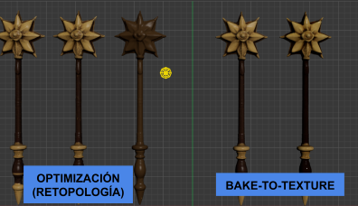
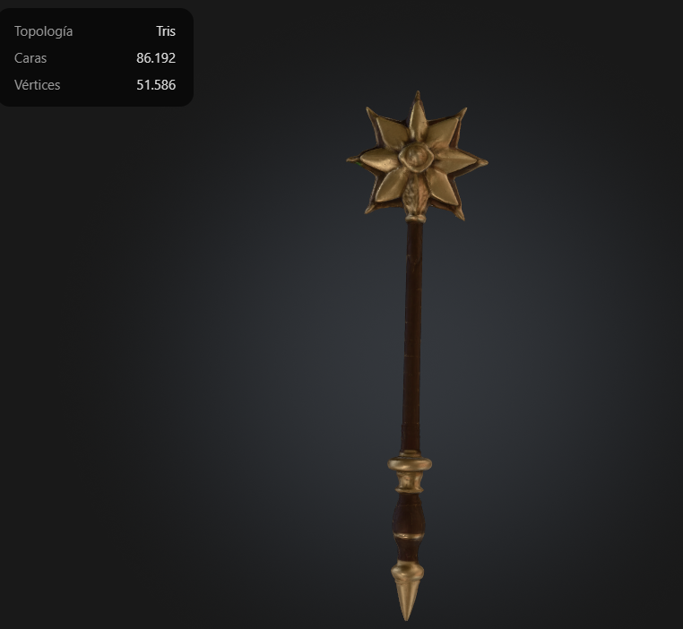
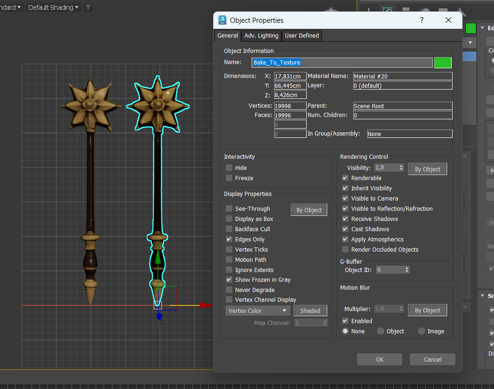
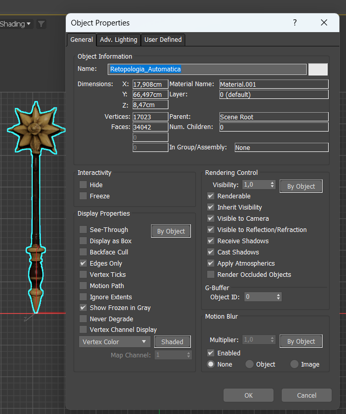
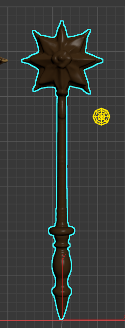
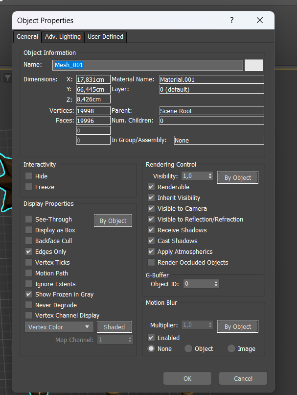
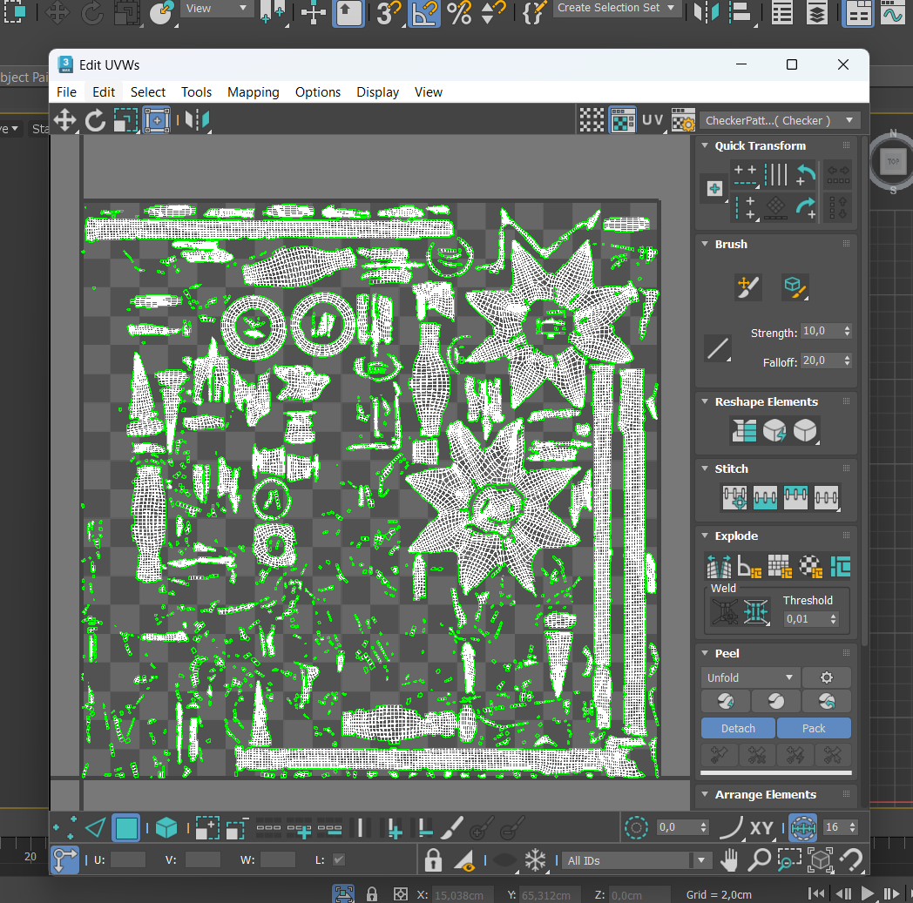
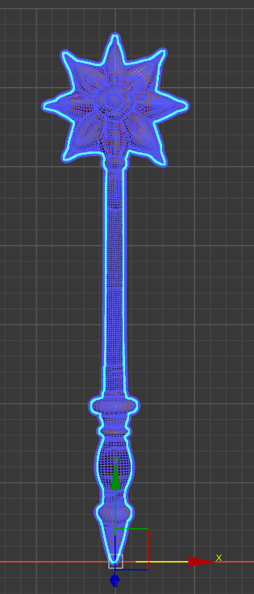
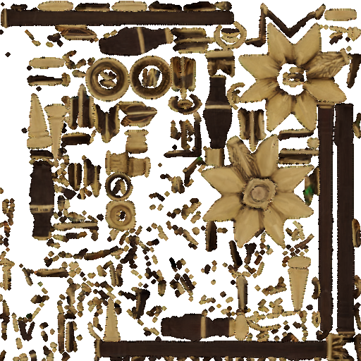
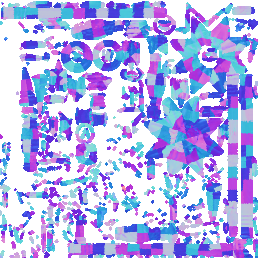

# Optimización, bakeado y exportación de un modelo 3D

> Práctica de la asignatura **Realidad Virtual Avanzada**
> Autora: **Olaia Picabea Sainz** · Herramienta: **Autodesk 3ds Max**

En esta práctica partí de un modelo *high poly* generado con IA y lo convertí en un modelo *low poly* listo para tiempo real. El proceso tiene tres partes: retopología (automática y semiautomática), mapeado de coordenadas UV y *bake to texture* de los mapas de color y normales.

📄 [Leer la documentación completa (PDF)](documentacion_Olaia_Picabea.pdf)

---

## Resultados

| Modelo | Técnica | Caras | Respecto al original |
|---|---|---|---|
| Original (*high poly*) | Generado con IA (Meshy) | **86.192** | 100 % |
| Retopología automática | ProOptimizer | **34.042** | ~39,5 % |
| Retopología semiautomática | Subdivide + Retopology | **~20.000** | ~23 % |
| Modelo final | Low poly semiautomático + texturas bakeadas | **~20.000** | ~23 % |

Es decir, el modelo final tiene **un 77 % menos de caras** y mantiene el aspecto visual del original gracias a los mapas de color y normales bakeados a 512 × 512.

| Original (*high poly*) | Final (*low poly* + bake) |
|---|---|
|  |  |

## 1. Modelo 3D

Generé el modelo con **Meshy**, una herramienta de IA. Le pedí una varita de estilo medieval, de madera, con una estrella en la parte superior. A propósito, le pedí que tanto la geometría como las texturas fueran complejas, para que la mejora de la retopología se notara sin perder calidad.

Después lo preparé en 3ds Max:

- Comprobé el número de caras en las propiedades del objeto: **86.192**.
- Verifiqué que las unidades del layout estaban en centímetros y escalé el modelo a unos **60 cm** de altura usando un plano de referencia.
- Apliqué **Reset XForm** para ajustar la escala a las unidades del viewport.
- Convertí el *Editable Mesh* en *Editable Poly*.

## 2. Optimización (retopología)

Antes de empezar comprobé que las caras del modelo estaban conectadas. Después hice dos copias del original, una para cada técnica.

### Retopología automática

Apliqué el modificador **ProOptimizer** con *Keep Textures* activado y fui bajando el *Optimization Level* hasta quedarme con el **39,5 % de los vértices**. El resultado fue un modelo de **34.042 caras**.

### Retopología semiautomática

Al aplicar **Retopology**, 3ds Max dio un error porque el modelo tenía vértices duplicados. Lo resolví así:

1. **Weld** de vértices con un umbral de 0,01, seguido de *Remove Isolated Vertices*.
2. Modificador **Subdivide** con *Variable Curvature*, para que se genere más geometría en los ángulos cerrados de la malla.
3. Modificador **Retopology** para generar quads, con un *Face Count* de **20.000** (alrededor del 23 % del original) y *Regularize* = 1 para obtener quads más uniformes entre sí.

| Malla resultante | Propiedades |
|---|---|
|  |  |

## 3. Mapeado de coordenadas UV

- Copié el modelo original y el optimizado para no modificar los originales.
- Para distinguirlos, quité los materiales del optimizado y le apliqué un color liso.
- Coloqué los dos modelos exactamente en la misma posición.
- Apliqué **Unwrap UVW** al modelo optimizado y, en el editor, usé **Flatten Mapping** para generar los UVs automáticamente.

## 4. Bake to Texture

1. Con el modelo optimizado seleccionado, abrí **Rendering → Bake To Texture** y añadí los mapas **Beauty** y **Normal**.
2. En *Projected From* enlacé el modelo original. El *cage* que se generó era demasiado grande, así que lo reseteé y aumenté ligeramente el *Push Amount*.
3. Fijé el *Image Size* a **512** y el *Output* a un nuevo material **PBR (Metal/Rough)**. Conecté el mapa Beauty al *Base Color Map* y el Normal al *Normal Map*.
4. Tras el bake, apliqué **Collapse To** sobre la proyección.

**Problema encontrado.** El primer bakeado salió mal por falta de luz en la escena. Lo solucioné añadiendo una **Arnold Light de tipo Skydome** con intensidad 2 y repitiendo el proceso.

### Texturas generadas

| Base color (Beauty) | Normal map |
|---|---|
|  |  |

## Contenido del repositorio

- `practica_RVAV_Olaia_Picabea.max`: escena de 3ds Max con los cinco modelos del proceso:
  - `Modelo_Original`: modelo *high poly* original.
  - `Modelo_Original001`: copia del original usada como fuente del bake.
  - `Retopologia_Automatica`: resultado de ProOptimizer.
  - `Retopologia_Semiautomatica`: resultado de Retopology.
  - `Bake_To_Texture`: modelo final *low poly* con las texturas bakeadas.
- `FBX/practica_RVAV_Olaia_Picabea.fbx`: modelo final exportado con las texturas incrustadas.
- `textures/`: mapas Beauty y Normal generados en el bake (512 × 512).
- `documentacion_Olaia_Picabea.pdf`: documentación paso a paso de la práctica.
- `docs/img/`: imágenes de este README, extraídas de la documentación.

## Lo que he aprendido

- Comparar la retopología automática con la semiautomática: reducción de caras frente a calidad y regularidad de la malla.
- Limpiar una malla generada por IA (vértices duplicados y aislados) antes de poder procesarla.
- Generar UVs y transferir el detalle de un modelo *high poly* a uno *low poly* mediante mapas de color y normales.
- Ajustar el *cage* de proyección y la iluminación de la escena para obtener un bake correcto.
